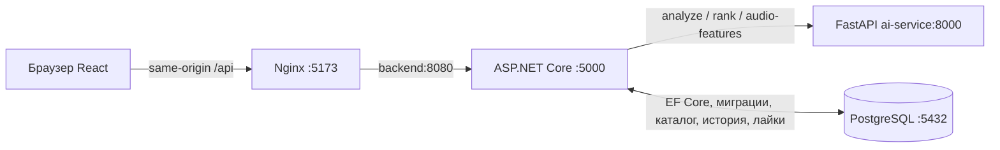

# ContextIQ

Учебная мультимодальная платформа: анализирует текст и эмодзи, предполагает настроение и контекст, рекомендует контент и исследует акустические характеристики звука. Анализ эмоций не является медицинской диагностикой. Аудио используется для физических измерений; распознавание речи и определение эмоций по голосу пока не реализованы.

## Архитектура и стек



React 19, TypeScript, Vite, React Query, Recharts; .NET 10 Minimal API, EF Core; PostgreSQL 17 (SQLite для разработки); Python 3.12 в Docker, FastAPI, Pydantic, NumPy, SciPy; Nginx, Docker Compose. JS-зависимости закреплены в `frontend/package-lock.json`.

```text
ai-service/       AI-анализ, ранжирование, физика, каталог и pytest
backend/          API, БД, миграции SQLite/PostgreSQL и xUnit
frontend/         интерфейс, PCM WAV recorder, Vitest и Playwright
docker-compose.yml
```

## Запуск одной командой

Нужен Docker Desktop с Linux containers и Compose. Из корня репозитория:

```sh
docker compose up --build
```

| Сервис | Адрес |
|---|---|
| Приложение | http://localhost:5173 |
| Backend Swagger / health | http://localhost:5000/swagger / http://localhost:5000/api/health |
| Python Swagger / health | http://localhost:8000/docs / http://localhost:8000/health |
| PostgreSQL | Только внутри Docker network, `postgres:5432` |

`.env` необязателен: локальные значения уже заданы. Для своих настроек скопируйте `.env.example` в `.env`. Не добавляйте секреты в Git. По умолчанию `EMOTION_MODE=demo`: настоящие HTTP-запросы, PostgreSQL и ранжирование, анализ текста бесплатными правилами без LLM. Режим явно обозначен в UI. Статические frontend-заглушки отключены: `VITE_DEMO_MODE=false`. Для LLM-режима задайте `EMOTION_MODE=auto` и свой ключ локально.

Compose ждёт health checks PostgreSQL и Python. Backend применяет существующие EF migrations и импортирует 32 записи каталога. PostgreSQL хранит данные в named volume. `docker compose down` останавливает стек с сохранением данных. Логи: `docker compose logs --tail 100 backend ai-service`. Изменение `POSTGRES_PASSWORD` не меняет пароль уже инициализированной БД; это требует отдельной операции в PostgreSQL.

## Локальный запуск по отдельности

Нужны Python 3.12+ с NumPy/SciPy wheels, .NET SDK 10, Node 22.12+ (проверено с Node 24). В Windows используйте `npm.cmd`, если PowerShell запрещает `npm.ps1`.

Python, PowerShell из корня (создание окружения нужно только при его отсутствии):

```powershell
py -3.12 -m venv .venv
.\.venv\Scripts\python.exe -m pip install -r ai-service/requirements.txt
$env:EMOTION_MODE = 'demo'
Set-Location ai-service
..\.venv\Scripts\python.exe -m uvicorn app.main:app --host 127.0.0.1 --port 8000
```

Backend в другом терминале из корня:

```powershell
Set-Location backend
dotnet run --project ContextIQ.Api --launch-profile http
```

Development автоматически использует SQLite (`backend/ContextIQ.Api/contextiq.db`), миграции и каталог. Порт — 5000. Для PostgreSQL смотрите [backend/README.md](backend/README.md). Docker-адреса `postgres`/`ai-service` применяются внутри Docker network; `localhost` внутри контейнера относится к нему самому.

Frontend в третьем терминале из корня:

```powershell
Set-Location frontend
npm.cmd ci
npm.cmd run dev
```

Vite передаёт относительный `/api` на `127.0.0.1:5000`. `.env` frontend для этого не нужен. В контейнере proxy выполняет Nginx. CORS допускает `http://localhost:5173` для прямых обращений. На Linux/macOS замените `.venv\Scripts\python.exe` на `.venv/bin/python`, `npm.cmd` — на `npm`.

## Тесты

```powershell
cd ai-service
..\.venv\Scripts\python.exe -m pytest -v
cd ../backend
dotnet test
cd ../frontend
npm.cmd run build
npm.cmd run test
npm.cmd run lint
npx.cmd playwright install chromium
npm.cmd run test:e2e
```

Playwright требует запущенный Compose и использует синтетические WAV из `frontend/e2e/fixtures` для проверки аудио.

## Физический эксперимент

В разделе «Физика» запишите звук или загрузите PCM WAV. Браузер через AudioWorklet записывает mono и кодирует PCM16 WAV; C# пересылает multipart `file` в Python. Через реальный API возвращаются длительность, дискретизация, RMS, пик, доминирующая частота FFT и спектральный центроид. Для микрофона нужны разрешение и localhost/HTTPS.

## Ограничения

Demo-анализ текста — правила без клинической валидации. Каталог содержит 32 записи, внешние URL не заполнены. Лайки сохраняются, но модель на них не обучается. Текущая подборка `/results` хранится в React Query и исчезает при reload; история восстанавливается из БД. WAV ограничен 20 MiB/120 с, WebM/MP3 не поддерживаются. UI показывает осциллограмму записи и численные параметры. Амплитуда измерена в цифровых относительных единицах, без калибровки в Па/дБ SPL. Для production потребуются HTTPS, управление секретами, резервные копии и отдельная процедура миграций.
